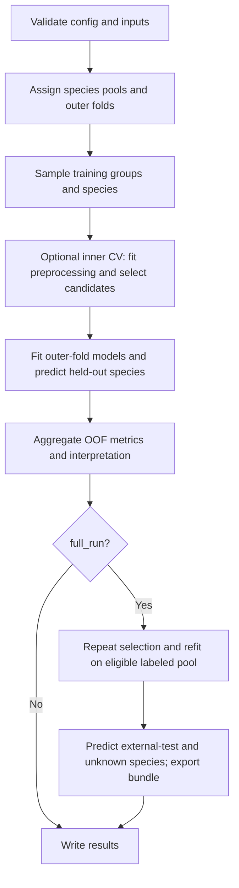

# Pipeline details

This page explains what each command learns, evaluates, and reuses. For commands
and settings, see the [CLI reference](cli-reference.md) and
[configuration](configuration.md).

## Training flow

### Pool and fold construction

Excluded species are removed first. Unknown-trait species become inference
targets. Eligible labeled species enter training/CV; missing contrast pairs and
optionally single-label groups are reserved for external testing. See
[pool assignment](data-format.md#metadata-tsv) for exact rules.

Groups remain intact in outer and inner CV. `logo` holds out one group;
`group_kfold` holds out several; `stratified_group_kfold` also approximates label
balance. Each training partition must contain both labels. Validation may be
single-label, in which case two-class metrics are `NA`.

The internal `training_validation` pool expands into per-fold `train` and
`validation` rows in `split_manifest.tsv`. External-test and inference species
never determine model preprocessing or candidate selection.

### Outer and inner CV

For each outer fold:

1. Optionally retain exactly `sampling.training_group_count` training groups.
   Rankings derive from the seed and repeat index; validation groups stay fixed.
2. Construct sampled training sets: one full set for `all_samples`, or balanced
   subsets for `group_balanced`. Compute optional sample weights within each
   fitted training subset.
3. If candidate selection is enabled, score candidates with grouped inner CV.
   Fit filters and scaling separately on each inner training partition.
   Select by mean score or the one-SE rule. `reuse_first_sample_set` reuses the
   candidates chosen from sampled set 0, not its fitted model state.
4. Fit preprocessing and selected models on each sampled outer training set.
   Without selection, fit all generated candidates directly.
5. Predict held-out species and aggregate member probabilities by mean or median.
   Apply the fixed 0.5 classification threshold and optional information gate.

Expression preprocessing follows the [configured transform/filter/scaling order](configuration.md#preprocess).
Sequence and combined modes use their [own fold-fitted preprocessing](amino-acid.md#preprocessing).
No learned means, filters, representatives, or coefficients cross a CV boundary.

After outer CV, PhenoRadar pools out-of-fold (OOF) predictions, computes macro
and micro metrics, and builds interpretation and stability diagnostics. Optional
group-bootstrap intervals resample intact OOF groups without refitting models.
The probability threshold is fixed at 0.5 and is never chosen from OOF results.

### Final refit

`full_run` repeats candidate selection and fitting on the eligible labeled
training/CV pool. Reserved external-test species remain held out. Group-count
limits, sampling, weights, and preprocessing apply again; a numeric training
count therefore also limits the exported model's training groups.

Final models predict external-test and unknown-trait species and are saved in
`model_bundle/`. Final-model interpretation describes that fitted ensemble;
outer-CV interpretation describes variation across held-out folds.

Unknown-species predictions from outer-fold models are sensitivity diagnostics.
They are neither OOF predictions for those unknown species nor formal confidence
intervals. Optional [phylogenetic imputation](phylogenetic-imputation.md) adds
post-prediction context without feeding labels back into training.

## Solver behavior

Logistic regression uses native glmnet binomial coordinate descent with an
unpenalized intercept. Internal standardization is disabled; configured
preprocessing supplies the model inputs. SVM and random forest use scikit-learn.

For grid/random searches, candidates sharing `alpha`, `thresh`, and `maxit`
(and the applicable combined-mode penalty ratio) use descending lambda paths
within each inner fold. Positive lambda gaps are bridged with internal
warm-start points no more than 0.05 decades apart. Only requested lambdas are
scored, without interpolation. Single-lambda fits remain single; zero has no
logarithmic bridge. TPE proposes candidates sequentially and uses individual fits.

Outer/final refits start new paths on their own training data, using matching
stronger candidate lambdas when available and retaining only the selected model.
Inner-fold coefficients and scalers are never reused. Coordinate-pass diagnostics
and `maxit` apply to the whole native path, including internal points.

An all-constant design uses the exact weighted intercept with zero coefficients.
Native errors or incomplete paths stop training. Changing a numerical path may
produce small coefficient/prediction differences, particularly for correlated
LASSO features.

## Missing values and information coverage

Neutral expression models fit scaling on observed training values and replace
missing standardized inputs with zero. Raw observation masks determine coverage;
a real observation at its training mean still counts as observed. Each
prediction uses coverage from its own fitted models.

The optional fixed coverage threshold adds no training or threshold search.
Raw metrics still evaluate all OOF species; selective summaries evaluate accepted
species and report the decision rate. See
[missing expression and abstention](configuration.md#missing-expression-and-abstention)
for formulas and [output semantics](output-artifacts.md#abstention) for use.

## Performance and reproducibility

Expression input is normalized, validated, and duplicate-summed into a temporary
run-local Parquet cache. `full_run` shares this cache across CV and refit, including
external/inference rows; invalid values in those pools can therefore fail before
CV. `cv_only` prepares only the training/CV rows. Caches are removed after use
or failure and are not reused between expression runs.

For `none`/`log1p`, inference matrices use the union of retained model features.
Rank transforms require the full original transform schema. Shared raw input
and row-local transforms avoid repeated scans; train-fitted statistics remain
local to each model. Chunked statistics and local-contribution workspaces reduce
temporary allocations but do not impose a total process-memory limit.
Sequence TPM has a separate [persistent input cache](amino-acid.md#caching-and-memory).

`runtime.n_jobs` budgets fold, candidate, sampled-set, and supported estimator
parallelism, with native thread limits. Sequence grid CV shares a memory-bounded
inner-fold queue across outer scopes, with separate refit processes.
Scoped seeds derive deterministically from `runtime.seed`; fixed inputs and
config preserve sampling and candidate order.

`runtime/tables/timing.tsv` records nested stage/fold/sample/candidate intervals
from one monotonic clock. Start with `scope=run, stage=total` for elapsed time;
parallel and nested durations must not be added. See
[timing and provenance](output-artifacts.md#timing-and-provenance) for details.

## Prediction flow

Expression bundle prediction:

1. Resolve prediction inputs and verify bundle version, required files,
   sizes/checksums, and schema/state consistency.
2. Validate and normalize selected input rows; align raw features to the saved
   schema before preprocessing.
3. Apply each model's frozen transforms, selected columns, and scaler.
4. Aggregate probabilities and apply the saved threshold and abstention policy.
5. Write predictions, evidence, figures, and provenance.

For rank transforms, alignment uses the complete `transform_feature_schema.tsv`;
extra features are removed before ranking. `none`/`log1p` can use only the
model-feature union. Missing features use the saved zero/missing-value policy
and produce warnings; zero overlap with model features is an error.

Prediction does not refit. Local contribution summaries include zero contribution
from members that omit a feature. Expression `predict` probabilities describe
bundle members; `full_run` can additionally show unknown-species predictions
from outer-fold models. Reference snapshots allow evidence figures after the
source run has moved. Sequence bundles enforce
[frozen alignment identity](amino-acid.md#prediction).

## Report flow

Reports select run directories, validate saved artifacts, load persisted metric
contracts, and rank by the chosen metric and macro/micro scope. Ties use start
time, then run ID. Different or unknown experiment fingerprints require explicit
mixed-experiment opt-in for ranking.

Non-strict ingestion records warnings and can leave runs unranked; strict mode
fails on missing or invalid artifacts. Software-version/build warnings are
reported separately from dataset/split compatibility. See the
[report command](cli-reference.md#report) for controls and
[report artifacts](output-artifacts.md#report-artifacts) for results.
